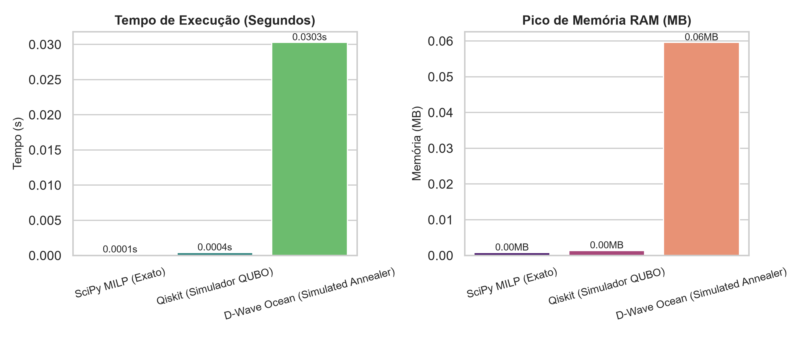
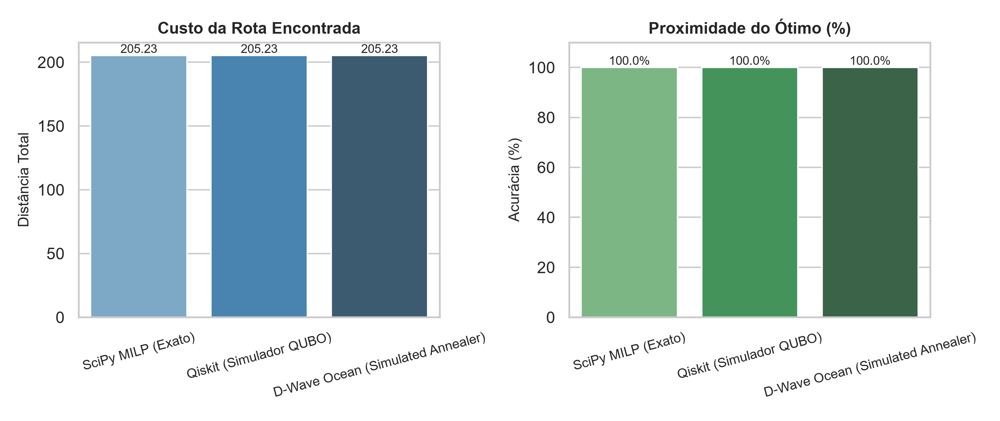

# Relatório Comparativo: Caixeiro Viajante (TSP - N=3)

## 1. Resumo Executivo
Este relatório apresenta a comparação quantitativa entre o algoritmo clássico exato e aproximações quânticas (Qiskit e D-Wave Ocean).

## 2. Tabela de Resultados do Benchmark

| Algoritmo | Rota Obtida | Custo Total | Proximidade do Ótimo (%) | Tempo (s) | Pico Memória (MB) | Status |
| :--- | :---: | :---: | :---: | :---: | :---: | :---: |
| SciPy MILP (Exato) | `0 -> 1 -> 2` | 205.23 | 100.0% | 0.0001 | 0.00 | Válida |
| Qiskit (Simulador QUBO) | `0 -> 1 -> 2` | 205.23 | 100.0% | 0.0004 | 0.00 | Válida |
| D-Wave Ocean (Simulated Annealer) | `1 -> 0 -> 2` | 205.23 | 100.0% | 0.0303 | 0.06 | Válida |

## 3. Comparativo de Recursos Computacionais
Abaixo é apresentado o consumo de tempo de processamento e alocação de memória RAM por abordagem:

## 4. Comparativo de Qualidade da Solução
Comparativo entre o custo obtido e o percentual de proximidade em relação ao gabarito real:

---
*Relatório gerado automaticamente pelo pipeline do projeto.*
